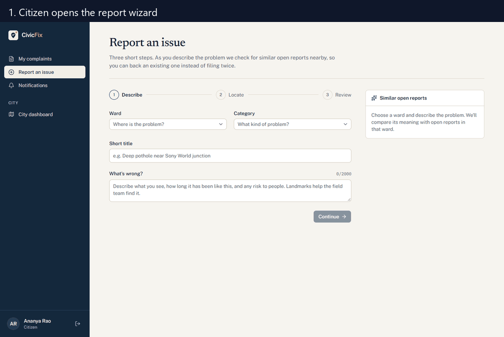
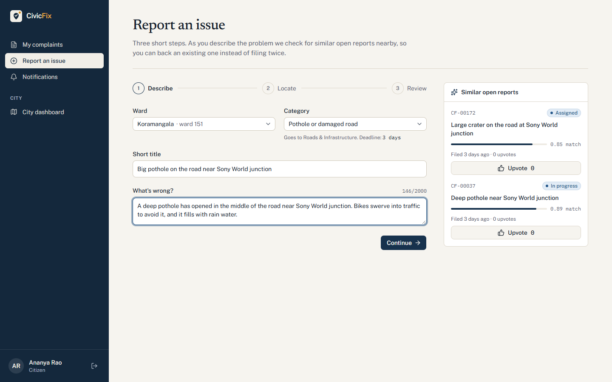
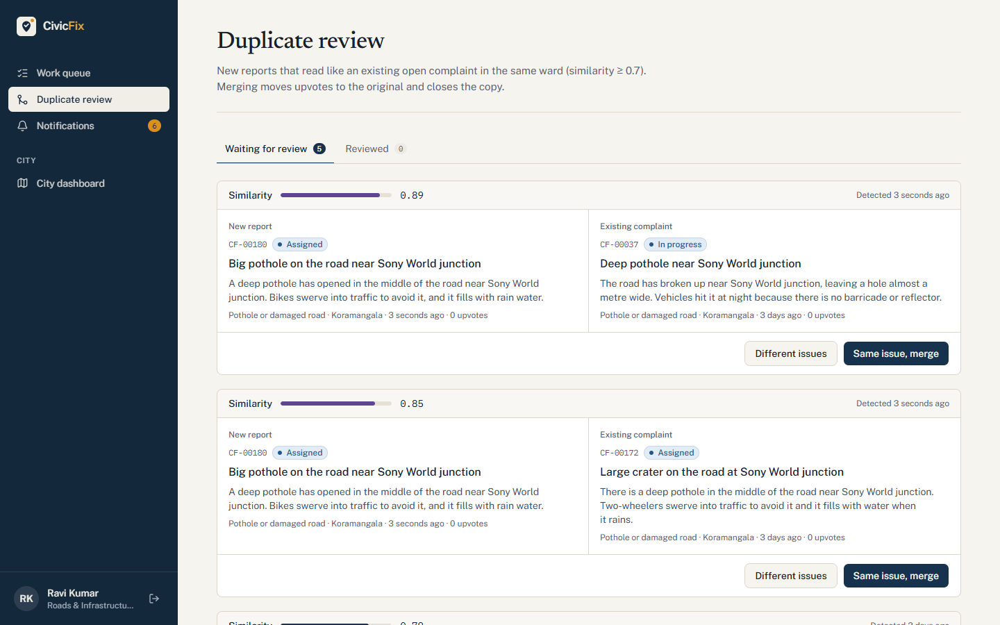
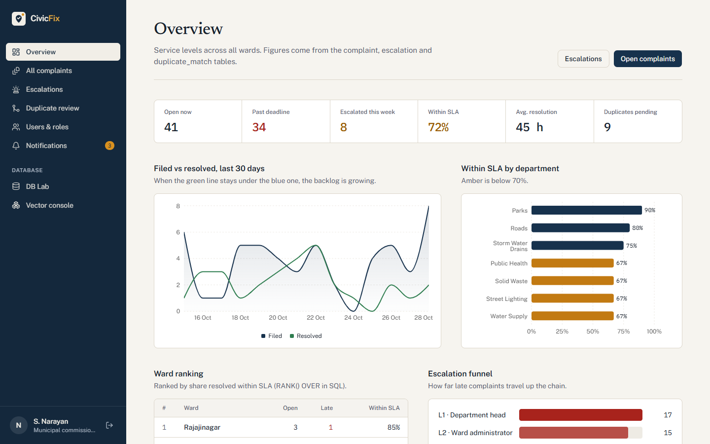
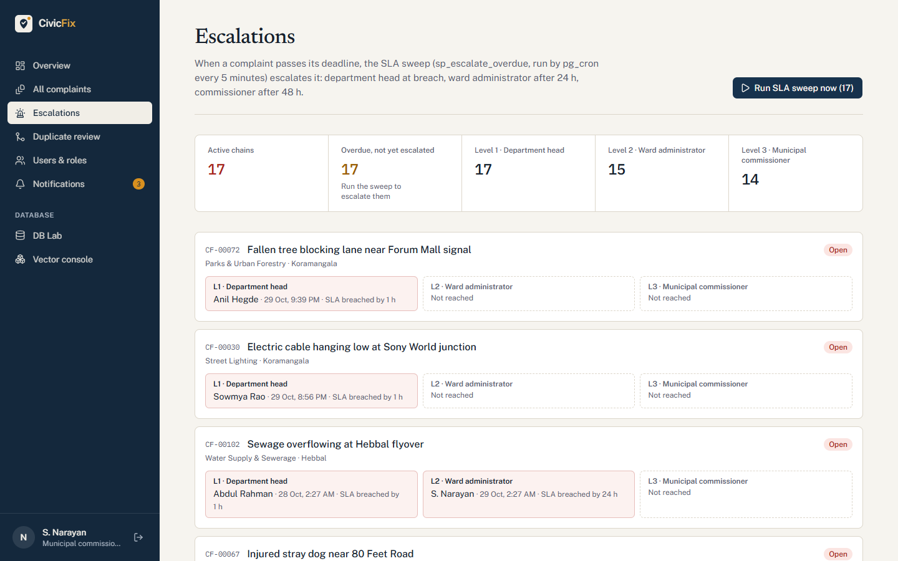
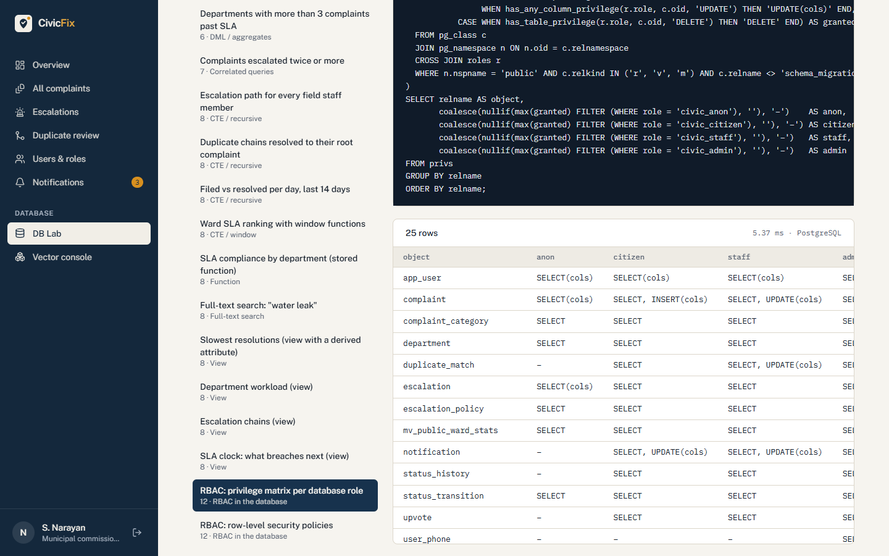
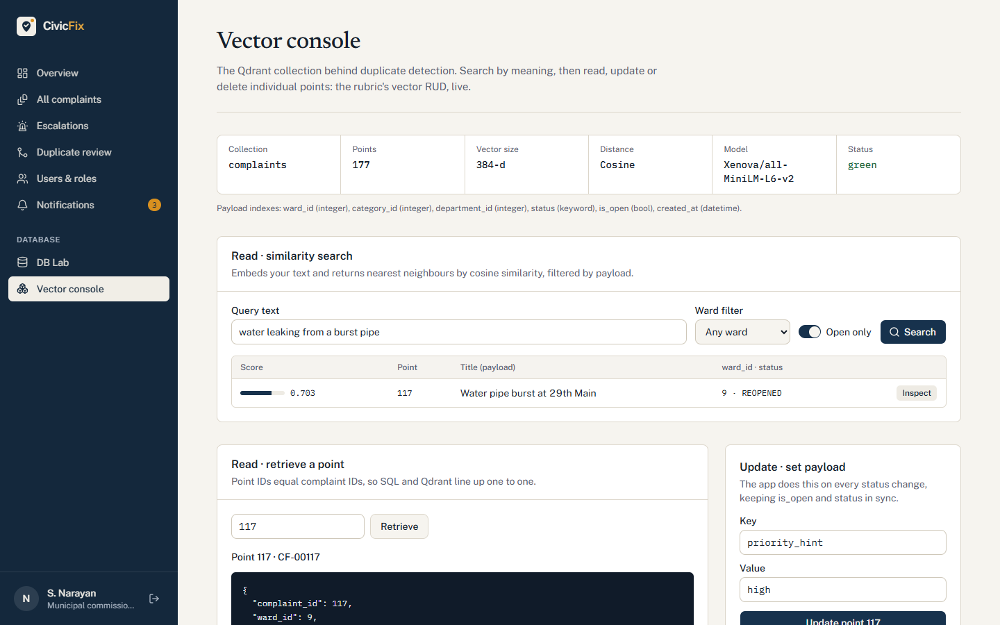
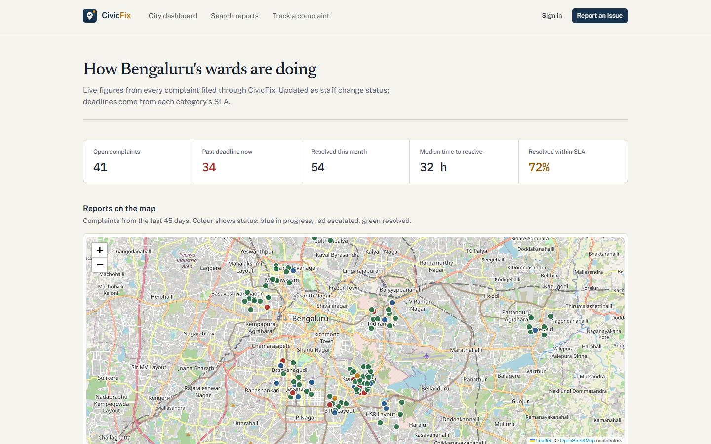
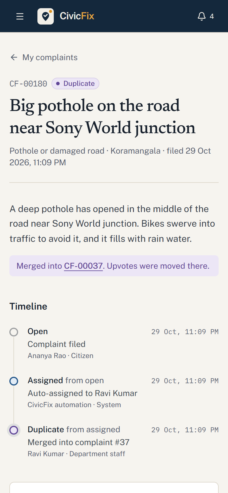

# CivicFix

Municipal civic grievance redressal for Bengaluru wards, with **semantic duplicate detection** and **SLA-based auto-escalation**. DBMS UE24CS351A mini project (Experiential Learning Level 3), PES University.

Citizens report potholes, garbage, leaks and broken streetlights. Each complaint is routed to the right department with a category deadline, checked against open reports by meaning (vector search), and escalated automatically (department head → ward administrator → commissioner) when the deadline slips.

| Item | Detail |
|---|---|
| **Team** | Vismay HS (PES1UG24AM325): frontend, views, RBAC/RLS, queries, vector DB · Ashvin Ronald Lobo (PES1UG24AM345): functions, procedures, triggers, cron, tests |
| **Stack** | Next.js 16 · React 19 · TypeScript · Tailwind v4 · shadcn/ui · React Bits · PostgreSQL 17 + pg_cron · Qdrant |
| **Status** | Runs end to end locally on PostgreSQL + Qdrant; verified by SQL tests, an HTTP smoke test and Playwright browser tests. Remaining: ER diagram v2, report, viva prep ([progress](docs/PROGRESS.md)) |

## Run it locally

Requires Node 22+ and Docker Desktop (with the Linux container engine running).

```bash
git clone https://github.com/VismayHS/CivicFix.git
cd CivicFix

# 1. Start PostgreSQL and Qdrant (first start applies every migration + the demo seed)
cp .env.example .env
docker compose up -d --build

# 2. Start the app against the real backend
cd web
cp .env.example .env.local
npm install
npm run vector:setup && npm run vector:reindex   # load Qdrant (~25 MB model downloads once)
npm run dev                                      # http://localhost:3000
```

The app connects as `civic_app`, a login role with no rights of its own that switches to the signed-in user's database role per request (see [RBAC](docs/database/rbac.md)). Use `DATA_SOURCE=mock` in `web/.env.local` only for the in-memory UI demo without the services. To start over with fresh data: `docker compose down -v && docker compose up -d`.

### Check that everything works

```bash
docker compose exec -T db psql -U postgres -d civicfix -f /civicfix/tests/smoke.sql   # workflow checks
docker compose exec -T db psql -U postgres -d civicfix -f /civicfix/tests/rbac.sql    # 56 GRANT/RLS checks
docker compose exec -T db psql -U postgres -d civicfix -f /civicfix/tests/rls_transitions.sql  # visibility + illegal transitions
docker compose exec -T db psql -U postgres -d civicfix -f /civicfix/tests/auto_close.sql       # 14 auto-close checks
cd web
npm run test:smoke   # every page for every role + main flows, over HTTP (app running)
npm run test:e2e     # the three role journeys in Chrome (Playwright)
```

### Demo accounts (password `civicfix123`)

| Role | Email |
|---|---|
| Citizen | `ananya@civicfix.test` |
| Staff (Roads, Koramangala) | `ravi.kumar@civicfix.test` |
| Ward admin (Koramangala) | `meera.iyer@civicfix.test` |
| Municipal commissioner | `commissioner@civicfix.test` |

The login page has one-click buttons for these.

## Screenshots



| | |
|---|---|
|  Report wizard: live semantic duplicate check |  Staff: duplicate review with similarity score |
|  Admin analytics |  Escalation chains and the SLA sweep |
|  DB Lab: privilege matrix read from the catalog |  Vector console on Qdrant |
|  Public city dashboard |  Phone layout |

All screenshots: [docs/screenshots/](docs/screenshots/) (regenerate with `npm run screenshots`).

## What's in the app

- **Public:** landing page, city dashboard (map, SLA by department, ward table), keyword search, complaint tracking by reference.
- **Citizen:** 3-step report wizard with live duplicate suggestions ("upvote this instead"), my complaints with SLA clocks, confirm or reopen, notifications.
- **Staff:** work queue sorted by time left, status changes limited to legal transitions, similar complaints, duplicate review (merge or keep separate).
- **Admin:** analytics (filed vs resolved, SLA by department, ward ranking, escalation funnel), all complaints with reassignment, escalation chains with "Run SLA sweep now" and "Run auto-close", users and roles, **DB Lab** (the rubric query catalogue, runnable), **Vector console** (Qdrant read, update, delete).

## Repository layout

```text
CivicFix/
├─ web/                   Next.js app
│  ├─ src/lib/data/       contract.ts · mock/ (in-memory demo) · postgres/ (the real backend)
│  ├─ src/lib/vector/     MiniLM embeddings + Qdrant calls
│  ├─ scripts/            seed export, query export, vector setup/reindex/calibrate, smoke test, screenshots
│  └─ e2e/                Playwright browser tests
├─ db/                    PostgreSQL + Qdrant
│  ├─ migrations/         001 schema · 002 reference data · 003 functions · 004 procedures
│  │                      005 triggers · 006 views · 007 roles, GRANTs, RLS · 008 pg_cron
│  │                      009 auto-close of resolved complaints
│  ├─ seed/               demo data (generated from the same dataset as the mock)
│  ├─ queries/            the 20 rubric queries (+ rbac-demo.sql)
│  ├─ tests/              smoke.sql, rbac.sql, rls_transitions.sql, auto_close.sql
│  └─ qdrant/             how to run the vector scripts
├─ docs/                  plan, context PDFs, schema v2, API contract, design, team workflow
└─ docker-compose.yml
```

## Documentation

Start with [docs/README.md](docs/README.md). Progress: [docs/PROGRESS.md](docs/PROGRESS.md). Database work: [docs/backend/](docs/backend/README.md). Key pages: [RBAC](docs/database/rbac.md), [vector DB and threshold calibration](docs/database/vector-db.md), [queries with outputs](docs/database/queries.md), [team workflow and task split](docs/team-workflow.md), [API contract](docs/api-contract.md), [schema v2](docs/database/schema-v2.md), [technology justification](docs/database/technology-justification.md), [design system](docs/design/DESIGN.md), [build plan PDF](docs/plan/status-and-build-plan.pdf).

## Rubric map

| Rubric item | Where |
|---|---|
| ER diagram, relational schema | `docs/diagrams/` (incl. `relational-schema-v2.png`), `docs/database/schema-v2.md` |
| DDL with constraints | `db/migrations/001_schema.sql` |
| Vector DB creation and RUD | Qdrant collection `complaints`, `/admin/vector`, duplicate detection, [vector-db.md](docs/database/vector-db.md) |
| DML, nested / correlated / recursive queries, joins | `db/seed/`, `db/queries/`, `/admin/db-lab`, [queries.md](docs/database/queries.md) |
| Procedures, functions, triggers, CTEs, views | `db/migrations/003`–`006`, `008` |
| Next.js interface, backend/API integration | `web/`, `web/src/lib/data/postgres`, `web/src/app/api/v1` |
| Authentication, roles, RBAC in database | `web/src/lib/auth`, `db/migrations/007_rbac_rls.sql`, `db/tests/rbac.sql`, [rbac.md](docs/database/rbac.md) |
